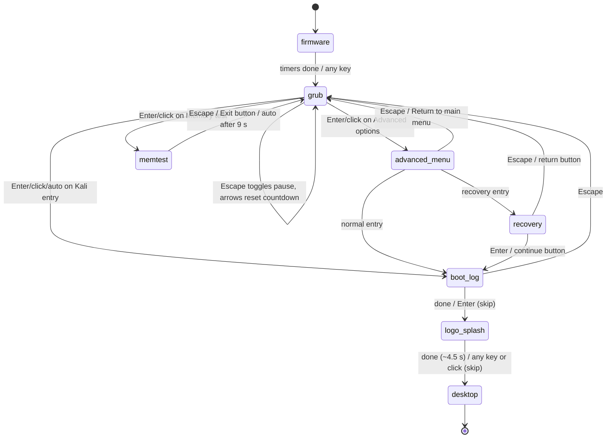

# Code Review — Kali Linux-style Portfolio (React + TypeScript + Vite + Tailwind)

**Reviewer:** senior front-end audit, performed by reading every file in `src/` plus the configs, and by running the project's own commands.
**Result file:** this document (`review.md`).
**Source code:** unchanged. No file in the project was modified to write this review.

**What was actually run during this review:**

- `npm run lint` → **exit 0** (0 problems).
- `npm run build` → **exit 0** (`tsc -b && vite build`, ~2.1 s).
- `vite preview` → **HTTP 200** on `/`.
- `git status` → **clean working tree** (all 4 commits in place; latest `feat: add Kali-style boot sequence`).
- Byte-level checks (`ls -la`, `du`) on `public/` and `src/assets/`.
- Class-level diff between `LogoSplash.tsx` and `LogoSplash.css` (all `lsplash-*` classes used in JSX exist in the stylesheet).

---

## 1. Project overview

This project is a **browser-based simulation of booting a Kali-style Linux machine** that ends in a desktop portfolio. The visitor sees a firmware flash, a working GRUB 2.06 menu with a 15-second countdown, optional advanced submenu (recovery mode), a memory test, a kernel/systemd boot log, a personalized Plymouth-style splash, and finally a desktop environment with windows, icons, a file manager, and a terminal. Nothing touches a real kernel: every stage is React state and timers. The desktop exposes three projects with descriptions, stacks, thumbnails, and a fake filesystem.

**Tech stack:**

| Dependency | Version | Purpose |
|---|---|---|
| `react`, `react-dom` | 19.3.1 | UI rendering, state, effects, refs |
| `lucide-react` | ^1.61.0 | Icon set (note: brand icons like `Github` were removed in this line — see finding F-01) |
| TypeScript | ~6.0.3 | Type checking via `tsc -b` |
| Vite | ^8.3.4 | Dev server, bundler |
| `@vitejs/plugin-react` | ^6.1.2 | React/JSX transform + HMR |
| `tailwindcss` + `@tailwindcss/vite` | 4.3.3 | Utility CSS (v4 style: no config file needed) |
| ESLint + `typescript-eslint` + `eslint-plugin-react-hooks` | — | Static checks (`npm run lint`) |

**Folder tree of `src/`:**

```
src/
├── App.tsx                      App root: `booted ? <Desktop /> : <BootSequence />`
├── main.tsx                     createRoot + <StrictMode>, imports index.css
├── index.css                    Tailwind import + all global styling/keyframes
├── App.css                      DEAD FILE — Vite template leftovers, not imported
├── LogoSplash.css               Dedicated stylesheet for LogoSplash (lsplash-* rules)
├── assets/
│   ├── Neon Dragon Linux Tech Wallpaper.png   842 KB dragon image (wallpaper + splash)
│   ├── Neon Linux User Emblem.png             1.5 MB, referenced nowhere
│   ├── hero.png                               13 KB, referenced nowhere
│   └── react.svg, vite.svg                    referenced nowhere
├── data/
│   └── projects.ts              Project type + 3 projects (files, stack, accent, image)
├── hooks/
│   └── usePrefersReducedMotion.ts   Reactive prefers-reduced-motion via useSyncExternalStore
└── components/
    ├── BootSequence.tsx         Boot stage machine (firmware → grub → …)
    ├── GrubMenu.tsx             Reusable GRUB menu w/ countdown
    ├── GrubSubmenu.tsx          Advanced-options submenu
    ├── LinuxBootLog.tsx         systemd-style boot log screen
    ├── RecoveryConsole.tsx      Recovery-mode diagnostics screen
    ├── MemoryTestScreen.tsx     memtest86+ simulation screen
    ├── LogoSplash.tsx           Plymouth-style splash w/ name/progress
    ├── Desktop.tsx              Desktop shell: top bar, dock, search, windows, icons
    ├── WindowFrame.tsx          Draggable window chrome (close/minimize/maximize)
    ├── FileManager.tsx          Fake filesystem browser with search + detail panel
    ├── TerminalApp.tsx          Simulated shell (allowlisted commands)
    └── DesktopIcon.tsx          Icon widget (single-click select, double-click open)
```

Public assets: `public/favicon.svg` (9.5 KB), `public/icons.svg` (5 KB), `public/wallpaper.jpg` (**0 bytes** — see finding F-02), `public/projects/{event-platform,delivery-app,book-store}.webp` (**all 0 bytes** — finding F-03).

---

## 2. App flow (most important)

**What the visitor sees, step by step:**

1. **Page load** — `index.html` mounts `src/main.tsx` → `App.tsx` renders `<BootSequence />` because `booted` is `false`.
2. **Stage 1 · firmware (~2.0 s)** —SeaBIOS-style lines print every 170 ms (`BootSequence.tsx`, `FIRMWARE_LINES`). Any non-modifier key skips ahead.
3. **Stage 2 · GRUB menu** — `GrubMenu` with 3 entries and a **15-second countdown**. The highlighted entry boots on countdown end, on Enter, or on click. Arrow keys move the selection **and reset the countdown**. Escape pauses/resumes the countdown (there is no `onEscape` on the main menu).
4. **Branch A · "Kali GNU/Linux Rolling 2026.1"** → `LinuxBootLog` (14 timed systemd-style lines, progress bar, Enter to skip, Escape returns to GRUB) → `LogoSplash` → desktop.
5. **Branch B · "Advanced options…"** → `GrubSubmenu` (no countdown): normal entry → same boot-log path; "(recovery mode)" → `RecoveryConsole` (10 diagnostic lines, then Enter = continue / Escape = return to GRUB) → boot-log path; "Return to main menu" → back to `GrubMenu`.
6. **Branch C · "Memory test (memtest86+)"** → `MemoryTestScreen` (bounded 9 s, Pass n/8, elapsed mm:ss, "Exit (Esc)" button + Escape, auto-returns to GRUB).
7. **Stage 3 · logo splash (~4.5 s)** — timed boot-log lines, rAF-driven smoothstep progress, identity reveal, one-time light sweep, exit fade. Any key or pointer click skips it.
8. **Stage 4 · desktop** — `LogoSplash.onDone` → `BootSequence.onComplete` → `App.setBooted(true)` → `<Desktop />` replaces the fixed overlay (conditional render, so nothing boots-page survives behind it).

**State variables and callbacks controlling each transition:**

| Transition | State / callback | Where |
|---|---|---|
| Boot → (never) desktop | `booted` in `App.tsx` via `onComplete` | `App.tsx` |
| firmware → grub | internal `stage = 'grub'` (or any-key skip) | `BootSequence.tsx` |
| grub → boot-log / advanced-menu / memtest | `onSelect(index)` from `GrubMenu` | `BootSequence.tsx` |
| countdown auto-boot | `GrubMenu` internal `secondsLeft` → `select(index)` | `GrubMenu.tsx` |
| submenu choice | `onBoot` / `onRecovery` / `onBack` + Escape = `onBack` | `GrubSubmenu.tsx` |
| recovery continue / return | `onContinue` (Enter or button) / `onReturn` (Escape or button) | `RecoveryConsole.tsx` |
| boot-log → splash (done) / → grub (Escape) | `onDone` + internal `settled` / `onEscape` | `LinuxBootLog.tsx` |
| memtest → grub | `onExit` (Escape, button, or auto after 9 s) | `MemoryTestScreen.tsx` |
| splash → desktop | `onDone` (also fired by `finish()` after full run, 550 ms fade) | `LogoSplash.tsx` |

**State machine diagram:**



ASCII version:

```
firmware ──(timers / any key)──▶ GRUB
GRUB ──Enter/click──▶ A) boot-log ──done/Enter──▶ logo-splash ──done/click──▶ DESKTOP
GRUB ──Enter/click──▶ B) advanced-menu ──▶ (boot-log | recovery ─▶ boot-log | back to GRUB)
GRUB ──Enter/click──▶ C) memtest ──Esc/Exit/9 s──▶ GRUB
boot-log ──Esc──▶ GRUB     advanced-menu ──Esc──▶ GRUB
```

---

## 3. File-by-file explanation

### `src/main.tsx`
- **Purpose:** creates the React root in `#root`, wraps `App` in `<StrictMode>`, imports `index.css`.
- **Props / inputs:** none.
- **State & refs:** none.
- **Effects & timers:** none.
- **Event handling:** none.
- **Rendering logic:** `<StrictMode><App /></StrictMode>`. StrictMode double-invokes effects in dev — all boot-stage timers restart cleanly, so it is harmless here (analysis, not runtime-proven).
- **Styling:** none of its own.
- **Accessibility:** none needed.
- **Connections:** uses `App.tsx`; loaded by `index.html`.

### `src/App.tsx`
- **Purpose:** single boolean gate between boot sequence and desktop.
- **Props / inputs:** none.
- **State & refs:** `booted: boolean`.
- **Effects & timers:** none (delegates to `BootSequence`).
- **Event handling:** none.
- **Rendering logic:** `booted ? <Desktop /> : <BootSequence onComplete={() => setBooted(true)} />` inside a fixed-height dark wrapper (`bg-[#070a0f]`).
- **Styling:** Tailwind only. 🤔 Note: wrapper color `#070a0f` differs from the desktop's own `#050913` (`Desktop.tsx`) — cosmetic inconsistency, invisible in practice.
- **Accessibility:** none directly; delegated to children.
- **Connections:** uses `BootSequence`, `Desktop`; is the only consumer of `BootSequence`.

### `src/index.css`
- **Purpose:** Tailwind v4 import + global reset + all global classes/keyframes outside the splash.
- **Contents (verified):** scrollbar styling `.terminal-scrollbar`, `.boot-fade-out`, `.stage-in`, dead `.splash-logo/.splash-glow/.splash-fill` rules (see F-14), `.boot-cursor` (blink), `.desktop-in`, `.desktop-menu`, keyframes `boot-fade-out`, `stage-in`, `splash-logo`, `splash-glow`, `splash-fill`, `boot-blink`, `desktop-in`, `menu-in`, plus a `prefers-reduced-motion: reduce` block that disables all of the above.
- **Connections:** imported by `main.tsx`; classes consumed by every boot screen and `Desktop`.

### `src/App.css`
- **Purpose:** none — Vite template leftovers (counter/hero/`#next-steps` styles). Not imported by any file (verified by search).
- **Findings:** dead code — see F-13.

### `src/LogoSplash.css`
- **Purpose:** complete theming for `LogoSplash` — CSS custom properties, vignette/grain backgrounds, `.lsplash-root` fixed overlay, logo box animation, glow + orbit ring, sweep, identity (`lsplash-name/role/divider`), progress track/fill, top/footer bars, exit animation, mobile media query, reduced-motion block.
- **Consumed by:** `LogoSplash.tsx` via `import "../LogoSplash.css"` (line 4, verified).
- **Verified:** every `lsplash-*` class referenced in the JSX is defined here (class-list diff produced an empty missing-set). Contains its own `@media (prefers-reduced-motion: reduce)` handling.

### `src/hooks/usePrefersReducedMotion.ts`
- **Purpose:** reactive boolean for the OS reduced-motion preference.
- **Props / inputs:** none. **Returns:** `boolean`.
- **State & refs:** none (uses `useSyncExternalStore`).
- **Effects & timers:** subscribe/unsubscribe through `matchMedia(REDUCED_MOTION_QUERY)` — cleaned up by `useSyncExternalStore` itself.
- **Event handling:** listens to `change` of the media query.
- **Rendering logic:** pure hook.
- **Styling:** none.
- **Accessibility:** this is the project's reduced-motion backbone — consumed by `LogoSplash` (and available to any stage).
- **Connections:** imported by `LogoSplash.tsx`. 🤔 The other boot screens (GRUB, log, memtest) do **not** consume it; their animations are handled purely in CSS (`stage-in` is disabled under reduced motion). Countdown still runs (numbers only), which is motion-safe.

### `src/data/projects.ts`
- **Purpose:** typed content: `Project`/`ProjectFile` types and 3 projects (Event Platform 2025, Delivery App 2024, Book Store 2024) with fake `files` trees, `stack`, `tags`, `accent` color, `image` path.
- **State & refs:** none (static data).
- **Effects & timers:** none.
- **Event handling:** none.
- **Rendering logic:** not rendered; consumed by `FileManager`, `TerminalApp`, `Desktop`.
- **Styling:** `accent` is converted to inline `style={{ color }}` in `Desktop.tsx`.
- **Accessibility:** n/a.
- **Connections:** used by `FileManager.tsx`, `TerminalApp.tsx`, `Desktop.tsx`. `projectById` helper (line 83) is exported but never imported (finding F-12).
- **Note:** all `image` fields point to the 0-byte `public/projects/*.webp` files (finding F-03).

### `src/components/BootSequence.tsx`
- **Purpose:** owns the whole boot stage machine and renders one stage at a time inside a fixed full-screen overlay.
- **Props / inputs:** `onComplete: () => void` (required).
- **State & refs:** `stage: 'firmware' | 'grub' | 'advanced-menu' | 'recovery' | 'boot-log' | 'logo-splash' | 'memtest'`; `firmwareCount: number`; `timersRef: useRef<number[]>`.
- **Effects & timers:** (1) firmware lines — 7 `setTimeout`s at 170 ms intervals + hand-off `setTimeout` to `grub`; cleanup clears all via `clearTimers`. Clean ✅. (2) firmware skip — window `keydown`, removed on unmount/stage change ✅.
- **Event handling:** any non-modifier key during firmware → `preventDefault()` + `setStage('grub')` (line ~86-95). Modifier guard covers `metaKey || ctrlKey || altKey`, so F5 alone is swallowed (finding F-16, Low).
- **Rendering logic:** one conditional block per stage; `GRUB_ENTRIES` are the three menu options; GRUB `onSelect` maps index 1 → submenu, 2 → memtest, else boot-log.
- **Styling:** fixed overlay `bg-black font-mono`, `.stage-in` entry animation per stage (rule in `index.css`).
- **Accessibility:** firmware hint "press any key…" is `text-neutral-700` on black (contrast problem, finding F-10); no touch fallback for "any key" — but the stage auto-advances, so mobile users are only exposed ~2 s (acceptable).
- **Connections:** parent `App.tsx`; children `GrubMenu`, `GrubSubmenu`, `RecoveryConsole`, `LinuxBootLog`, `LogoSplash`, `MemoryTestScreen`; imports `usePrefersReducedMotion` indirectly only through children.

### `src/components/GrubMenu.tsx`
- **Purpose:** reusable GRUB 2.06-style menu: box-drawing frame, clickable entries, countdown.
- **Props / inputs:** `entries: string[]`, `onSelect: (index) => void`, optional `onEscape`, `countdownSeconds` (0 = off), `header`, `helpLines`, `defaultIndex` (typed `GrubMenuProps`).
- **State & refs:** `index` (highlighted entry), `secondsLeft`, `paused` (hover/Escape pause); refs `autoBootFiredRef`, `selectRef`, `escapeRef` (kept current via effects so handlers stay fresh).
- **Effects & timers:** countdown is a single chained `setTimeout` (1 s per tick) with cleanup on every render of the effect — cannot continue unmounting ✅; fires `select(index)` when reaching 0, guarded by `autoBootFiredRef` so it can never double-fire.
- **Event handling:** window `keydown`: `ArrowUp/Down` → `move(±1)` + reset `secondsLeft` to full; `Enter` → `select(index)`; `Escape` → `onEscape` if provided, else pause/resume. All call `preventDefault`. Mouse: entry click → `select`; container `onMouseEnter/Leave` pauses/resumes.
- **Rendering logic:** two boxes rendered (narrow `BOX_INNER_MOBILE = 32` chars for phones, wide `BOX_INNER = 66` for ≥sm), one hidden per breakpoint; entries are `<button role="menuitem" aria-selected>`.
- **Styling:** highlighted entry `bg-blue-800/80 text-white` (GRUB-like blue), help text `text-neutral-500` (low contrast — finding F-10), rules `stage-in` from `index.css`.
- **Accessibility:** keyboard works globally without focus being inside the menu; `Enter` on a focused entry button is naturally prevented from double-firing because the global handler `preventDefault`s first. 🤔 Gaps: no `aria-live` announcement of selection changes, and buttons sit in no `role="menu"` container (finding F-11).
- **Connections:** used by `BootSequence` (main menu) and `GrubSubmenu`.

### `src/components/GrubSubmenu.tsx`
- **Purpose:** advanced-options submenu; pure composition over `GrubMenu`.
- **Props / inputs:** `onBoot`, `onRecovery`, `onBack` (all `() => void`, required).
- **State & refs:** none.
- **Effects & timers:** none.
- **Event handling:** via `GrubMenu` — `onSelect` maps 0 → `onBoot`, 1 → `onRecovery`, 2 → `onBack`; `onEscape` = `onBack`.
- **Rendering logic:** 3 entries: normal, "(recovery mode)", "Return to main menu".
- **Styling:** inherited from `GrubMenu` (`GNU GRUB version 2.06-13` header).
- **Accessibility:** inherited (Successfully has Escape).
- **Connections:** used by `BootSequence`; uses `GrubMenu`.

### `src/components/LinuxBootLog.tsx`
- **Purpose:** systemd-style scrolling log with a subtle progress bar.
- **Props / inputs:** `onDone`, `onEscape` (both required `() => void`).
- **State & refs:** `lineCount`, `settled`; refs `timersRef`, `finishedRef`, `onDoneRef`, `onEscapeRef`.
- **Effects & timers:** 14 lines × 170 ms `setTimeout`s + settle timer + auto-done timer; all cleared in effect cleanup and by `stopTimers` ✅. `skip` (Enter) clears timers, prints all lines, and finishes after 250 ms ✅.
- **Event handling:** window `keydown`: `Escape` → `onEscape` (stop timers, guarded by `finishedRef`); `Enter` → `skip`. `Tab`/modifier keys ignored.
- **Rendering logic:** `LINES.slice(0, lineCount)` inside a `terminal-scrollbar` overflow container; footer progress bar with `width: ${progress}%` and helper text.
- **Styling:** `LINE_CLASS` map (`text-neutral-400/500/300`, `text-blue-300/90`); class `stage-in`; `.terminal-scrollbar` from `index.css`.
- **Accessibility:** 🤔 no `aria-live` on the log (intentional — would spam screen readers; acceptable for a simulation). Progress is textual (`{progress}%`), so it changes state without a progressbar role — acceptable but not ideal.
- **Connections:** used by `BootSequence` (both normal and recovery paths).

### `src/components/RecoveryConsole.tsx`
- **Purpose:** recovery-mode diagnostic shell simulation.
- **Props / inputs:** `onContinue`, `onReturn` (required).
- **State & refs:** `lineCount`; refs `timersRef`, `finishedRef`, `onContinueRef`, `onReturnRef`.
- **Effects & timers:** 10 lines × 420 ms; when `ready` (`lineCount >= LINES.length`) an effect stops timers and sets `finishedRef` ✅.
- **Event handling:** window `keydown`: `Escape` → `onReturn`; `Enter` — only when `ready` — → `onContinue`; both `preventDefault`. Buttons mirror both actions for mouse/touch.
- **Rendering logic:** header, mono log block, then action row + hint once `ready`.
- **Styling:** `stage-in`, mono borders `border-neutral-700`/`border-blue-500/40`; action buttons are custom-styled (`px-4 py-2 font-mono`).
- **Accessibility:** buttons are real `<button>`s with text; keyboard path exists. 🤔 Hint contrast `text-neutral-500` is light (finding F-10).
- **Connections:** used by `BootSequence`.

### `src/components/MemoryTestScreen.tsx`
- **Purpose:** bounded memtest86+ simulation.
- **Props / inputs:** `onExit` (required).
- **State & refs:** `elapsedMs`; ref `onExitRef`.
- **Effects & timers:** `setInterval` at 100 ms clamped to `TOTAL_MS = 9000` — **cannot run forever** ✅; auto-exit `setTimeout` 2600 ms after 100% ✅; Escape window listener ✅.
- **Event handling:** Escape → `onExitRef.current()`; button → same. No touch-only gap: button exists.
- **Rendering logic:** stats grid (8 CPUs, caches, chipset, errors 0), rotating `TEST_LABELS` derived from elapsed time, PASS 1–8, `mm:ss` elapsed, ASCII bar `█/░` (34 blocks), percentage, completion message.
- **Styling:** `stage-in`; border panel; bar in `text-blue-400` `<pre>`.
- **Accessibility:** disclaimer rendered (`"Visual simulation only — this page does not test your computer's RAM."`) ✅. 🤔 The bar itself has no `role="progressbar"`/`aria-valuenow` (finding F-15, Low — the `{progress}%` text is adjacent, visible to AT only when it re-announces, which it won't without aria-live).
- **Connections:** used by `BootSequence`.

### `src/components/LogoSplash.tsx` (371 lines)
- **Purpose:** Plymouth-style final boot screen: timed boot logs + smoothstep progress + identity + logo + light sweep + exit fade.
- **Props / inputs:** `onDone: () => void` (required), `durationMs?: number = 3800`, `blendBlack?: boolean = true`.
- **State & refs:** `progress` (0–100), `exiting`, `complete`, `visibleLogs`; refs `fillRef` (bar node, animated via `transform: scaleX` to avoid re-render cost), `finishedRef`, `onDoneRef`, `timersRef`, `rafRef`, `finishRef`.
- **Effects & timers:** (1) main effect `[durationMs, reducedMotion]` — resets state asynchronously (`queueMicrotask`, per lint rule `react-hooks/set-state-in-effect`), schedules `BOOT_LOGS` appearances at `250 + at*durationMs` and drives a `requestAnimationFrame` loop computing `smoothProgress(t)`; at `t ≥ 1` schedules `finishRef.current()` after 320 ms. Cleanup cancels rAF + timers ✅. (2) `finishRef` sync effect. (3) skip listeners (`keydown`, `pointerdown`) — added once, removed on unmount ✅.
- **Event handling:** any non-modifier key or any pointer click → `finish()` → 100 %, log reveal-all, 550 ms `.lsplash-exit` fade → `onDone`. 🤔 Mixed input: rapid Enter-mashing from the boot-log can skip the splash instantly (finding F-08).
- **Rendering logic:** header bar, log section (aria-live off), center block (glow, orbit, masked sweep, logo ``, identity, progressbar with full ARIA), footer. `blendBlack` toggles `mix-blend-mode: screen`.
- **Styling:** entire look lives in `LogoSplash.css` (`lsplash-*`); timing constants: `EXIT_MS = 550`, `REDUCED_MOTION_MS = 350`, rAF start offset 400 ms, end hold 320 ms.
- **Accessibility:** exemplary — `role="progressbar"` with `aria-valuemin/max/now`, `aria-busy`, `aria-label` on the splash, reduced-motion path fires `onDone` after 350 ms with animations disabled in CSS.
- **Connections:** used by `BootSequence`; uses logo asset, hook, stylesheet. The `dragonWallpaper` is also rendered as a CSS mask for the sweep.

### `src/components/Desktop.tsx` (~700 lines)
- **Purpose:** the portfolio desktop shell — top bar, app menu, search palette, icon rail, identity hero, decorative system monitor, dock, minimized-window switcher, and all mounted windows.
- **Props / inputs:** none.
- **State & refs:** `windows: DesktopWindow[]`, `selectedIcon`, `menuOpen`, `searchOpen`, `searchQuery`, `now`.
- **Effects & timers:** 1 s clock interval — cleaned ✅; Escape-to-close listener for menu/search — cleaned, dependency `[menuOpen, searchOpen]` ✅.
- **Event handling:** menu/search/power buttons, icon select/open, dock buttons, taskbar switcher; `openWindow` dedupes by `kind + projectId` and raises `zIndex`.
- **Rendering logic:** wallpaper stack `/wallpaper.jpg` → dragon PNG; header with clock; `menuOpen`/`searchOpen` popups; icon rail (Terminal, Files, Browser→about, Resume→about, projects, Trash→files); windows map (`minimized && return null`): `TerminalApp` (with `onMinimize`, `onOpenProject`), `About` inside `WindowFrame` (with minimize), `FileManager` (no `onMinimize` — finding F-17); dock; switcher listing minimized windows via `formatWindowLabel`.
- **Styling:** Tailwind utility-heavy; uses `h-dvh min-h-[520px]` for mobile viewport height ✅; `desktop-in`/`desktop-menu` from `index.css`; inline wallpaper layering with the dragon PNG as fallback.
- **Accessibility:** aria-labels on icon-only buttons (search, power, dock apps), `aria-expanded` on menu trigger, Escape shortcuts, all decorative layers `aria-hidden`. 🤔 `PROFILE_LINKS` placeholders point to generic URLs (finding F-04).
- **Connections:** uses `DesktopIcon`, `FileManager`, `TerminalApp`, `WindowFrame`, `projects`, dragon logo. Used by `App.tsx`.

### `src/components/WindowFrame.tsx`
- **Purpose:** window chrome: title bar with icon/title, close/minimize/maximize, pointer-dragging.
- **Props / inputs:** `title`, optional `icon` (ReactNode), `children`, `onClose` (required), optional `onMinimize`, `initialPosition`, `initialSize`, `zIndex`.
- **State & refs:** `position`, `size`, `maximized`, `dragRef` (pointer id + offsets).
- **Effects & timers:** none (all pointer events are handlers).
- **Event handling:** `onPointerDown` on title bar (left button only, ignores `button` targets, `setPointerCapture`); `onPointerMove` clamps `x/y` with `Math.max(0, …)` 陽 only — no right/bottom clamp (finding F-05, `WindowFrame.tsx:56-57`); `onPointerUp/Cancel` releases capture. Maximize toggles a full-viewport style but also resets `position {0,0}` + `initialSize` (un-maximize loses the window's previous position — finding F-06, Low).
- **Rendering logic:** absolute-positioned panel, maximized branch uses `width/height: 100%`.
- **Styling:** Tailwind (rounded panel, gradient title bar); relies on parent for layering via `zIndex` style.
- **Accessibility:** labeled icon buttons (`aria-label="Minimize|Maximize|Close"`); drag is mouse-only (no keyboard window movement — common for web demos). 🤔
- **Connections:** used by `Desktop` (About), `FileManager`, `TerminalApp`.

### `src/components/FileManager.tsx`
- **Purpose:** fake file browser: home → projects → project detail, with search filter and details sidebar.
- **Props / inputs:** `onClose` (required), `zIndex?: number = 10`, `initialProjectId?: string`.
- **State & refs:** `location: 'home' | 'projects' | 'project'`, `activeProjectId`, `selected`, `query`.
- **Effects & timers:** none.
- **Event handling:** `../` up button, place buttons, entry select (`onSelect`) / open (`onDoubleClick` on folders only), search input.
- **Rendering logic:** `HOME_ENTRIES` static; projects listing from `projects`; detail panel shows thumb + description + stack chips. `ProjectThumb` component has an `onError` fallback to a colored letter tile — good defensive design that also masks finding F-03 in production.
- **Styling:** Tailwind; inherits `WindowFrame` chrome.
- **Accessibility:** 🤔 double-click opening only — no Enter/button alternative, so keyboard-only users can navigate visually but cannot open a project folder. `aria-label="Go up"` present.
- **Connections:** used by `Desktop`; uses `WindowFrame`, `projects`.

### `src/components/TerminalApp.tsx`
- **Purpose:** simulated shell over the virtual filesystem.
- **Props / inputs:** `onClose` (required), `onMinimize?`, `zIndex? = 10`, `onOpenProject?: (id: string) => void`.
- **State & refs:** `lines` (output log), `input`, `cwd`, `history`, `historyIndex`; refs `scrollRef`, `inputRef`.
- **Effects & timers:** one effect scrolls to bottom on `lines` change ✅ (no timer).
- **Event handling:** form submit → `run(command)`; `onKeyDown` ArrowUp/Down for history (`TerminalApp.tsx:192-210`); container click focuses the input.
- **Rendering logic:** allowlisted commands only — `help ls cd pwd cat projects open whoami neofetch date clear exit`. `cat` works off the listing (no real file access), `open` matches project names and calls `onOpenProject`. Unknown commands produce a friendly error.
- **Styling:** dark terminal colors (`emerald`/`cyan`/`rose`), `terminal-scrollbar` from `index.css`.
- **Accessibility:** 🤔 history navigation has an off-by-one quirk: pressing `ArrowDown` first sets `historyIndex` to −2, and the following `ArrowUp` computes `Math.min(-1, len-1)` which is < 0, so the first press is swallowed (finding F-07, Low — harmless, shell-like, but cheap to fix).
- **Security:** ✅ no `eval`, no `innerHTML`, no network calls; input stays within the allowlist. Verified across the file.
- **Connections:** used by `Desktop`; uses `WindowFrame`, `projects`.

### `src/components/DesktopIcon.tsx`
- **Purpose:** reusable desktop icon (label + framed icon).
- **Props / inputs:** `label` (required string), `icon` (required ReactNode), optional `selected`, `onSelect`, `onOpen`.
- **State & refs:** none.
- **Effects & timers:** none.
- **Event handling:** click = select, double-click = open (matching real desktops).
- **Rendering logic:** one `<button>`.
- **Styling:** Tailwind; selected ring vs hover tint.
- **Accessibility:** 🤔 `onOpen` is double-click-only — keyboard users can Tab to and "click" (select) but not open. No `aria-pressed`/`aria-selected` either. (Finding F-18 combined with FileManager behavior.)
- **Connections:** used by `Desktop`.

---

## 4. Styling & animation

### Custom classes and keyframes in `src/index.css`

| Class / keyframe | Used by | Notes |
|---|---|---|
| `.terminal-scrollbar` | `FileManager`, `LinuxBootLog`, `TerminalApp` | thin dark scrollbar |
| `.boot-fade-out` + `@keyframes boot-fade-out` | 🤔 **nothing currently** (old `BootScreen.tsx` used it; the file is gone) | dead class |
| `.stage-in` + `@keyframes stage-in` | every boot stage root | 0.25 s fade, disabled under reduced motion |
| `.boot-cursor` + `@keyframes boot-blink` | 🤔 **nothing currently** | leftover from old boot console |
| `.splash-logo`, `.splash-glow`, `.splash-fill` + 3 keyframes | 🤔 **nothing currently** — `LogoSplash` moved to `lsplash-*` rules in `LogoSplash.css` | dead on arrival of the splash rewrite (finding F-14) |
| `.desktop-in` + `@keyframes desktop-in` | `Desktop.tsx` root | desktop entrance |
| `.desktop-menu` + `@keyframes menu-in` | `Desktop.tsx` app menu popup | 0.18 s slide-in |
| `@media (prefers-reduced-motion: reduce)` block | — | disables all the above (also contains a `.splash-fill { width: 100% }` override that now does nothing) |

### The logo splash animation pipeline (`LogoSplash.tsx` + `LogoSplash.css`)

1. **Enter** — `.lsplash-root` fades in 500 ms (`lsplash-enter`).
2. **Boot logs** — 12 entries of `BOOT_LOGS` appear at `250 + log.at * 3800` ms (0.02 → 0.94 of the run), each with `lsplash-log-in` slide/fade.
3. **Logo reveal** — `.lsplash-logo-box` animates `lsplash-logo-in` (1100 ms, blur 8px → 0, rise + scale).
4. **Glow / orbit** — pulsing teal radial glow (`lsplash-glow`, infinite alternate) behind the logo.
5. **Light sweep** — one-time `lsplash-sweep` (1600 ms, 550 ms delay) masked to the logo's own PNG shape via `maskImage`.
6. **Progress** — a `requestAnimationFrame` loop maps elapsed/`durationMs` through a hand-tuned smoothstep curve (`smoothProgress` stops: fast start, stalls at ~0.43, finish surge) and sets `transform: scaleX(...)` directly on `fillRef` (no re-render per frame); the status label comes from `PHASES` thresholds.
7. **Identity** — name/role reveal at 200 ms delay (`lsplash-identity-in`).
8. **Exit** — `finish()` at curve completion (+320 ms hold) sets `complete`, applies the 550 ms `lsplash-exit` (fade + slight scale + blur, `visibility: hidden`), then `onDone()`.
9. **Skip** — any key/click calls `finish()` immediately (same visual path).
10. **Reduced motion** — CSS animations disabled; component renders final state instantly and calls `onDone` after 350 ms.

Sanity check of timings (verified arithmetic): main run ≈ 0.4 s start delay + 3.8 s curve + 0.32 s hold ≈ **4.5 s**, then 0.55 s fade — total ≈ 5 s. With GRUB (up to 15 s default) the complete first-visit boot can run ~25 s before the desktop; skipping is always one keypress away.

---

## 5. Audit findings

Severity: Critical = broken experience, High = important defect, Medium = noticeable defect, Low = polish.

| ID | Severity | File:line | Problem | Suggested fix |
|---|---|---|---|---|
| F-01 | High | `public/wallpaper.jpg:1` (= 0 bytes, verified by `ls -la`) | The desktop's **primary** wallpaper layer is an empty file; it renders only because the dragon PNG is set as a fallback layer. Any host claiming `/wallpaper.jpg` with real bytes later would also silently override your intended design. | Put the real landscape wallpaper there, or delete the URL from `Desktop.tsx`'s `backgroundImage` stack. |
| F-02 | High | `public/projects/*.webp` (all 3 files = 0 bytes) + `src/data/projects.ts:31,49,66` | All project thumbnails are dead references; the `ProjectThumb` `onError` fallback hides it, so visitors only ever see letter tiles. | Export real WebP images (or reuse one image per project), removing the fallback dependency. |
| F-03 | High | `Desktop.tsx:11` (`Link2 as Github`) | The GitHub icon is a generic `Link2` glyph because this `lucide-react` line no longer exports brand icons — the About window shows a link icon labeled "GitHub". | Replace with an inline SVG brand icon (simple-icons path) or accept the generic icon deliberately. |
| F-04 | Medium | `Desktop.tsx:29-33` (`PROFILE_LINKS`) | Placeholder profile URLs (`https://github.com/`, `https://www.linkedin.com/`, `mailto:kali@portfolio.dev`) and an on-screen reminder to replace them. | Fill in real accounts before publishing. |
| F-05 | Medium | `WindowFrame.tsx:56-57` | Drag clamping only applies `Math.max(0, …)` — windows can be dragged past the right/bottom screen edge and are hard to recover. | Clamp `x <= viewportWidth - w`, `y <= viewportHeight - h`. |
| F-06 | Low | `WindowFrame.tsx:104-108` (`toggleMaximize`) | Maximize fills the viewport, but the second press resets to `{x:0,y:0}` + `initialSize` instead of restoring the window's pre-maximize position/size. | Store the pre-maximized rect and restore it. |
| F-07 | Low | `TerminalApp.tsx:192-210` (`handleKeyDown`) | History navigation can sink `historyIndex` below −1 with repeated `ArrowDown`; the following `ArrowUp` is swallowed once (`Math.min(-1, …)` guard). | Clamp at −1: `if (historyIndex === -1) return;` or clamp `next >= -1`. |
| F-08 | Medium | `LogoSplash.tsx:263-277` (skip effect) | **Any** keydown/pointerdown skips the splash — mashing Enter at the end of the boot-log (or a stray click right after the stage swap) skips the entire splash you built. | Only skip on specific keys (Escape/Enter/Space) or add a short input grace period. |
| F-09 | Medium | `GrubMenu.tsx:64-73` (countdown effect) | The effect calls `select(index)` (parent `setStage`) synchronously when the countdown hits 0. It works and is guarded by `autoBootFiredRef`, but firing parent state updates directly from an effect body is fragile (a future re-run dependency can double-fire; such patterns are what the project's ESLint forbids elsewhere). | Move the auto-boot into the timeout callback, or use a `useEffectEvent`-style stable trigger. |
| F-10 | Medium | `BootSequence.tsx:104-106` (`text-neutral-700`), `MemoryTestScreen.tsx:167-169` (`text-neutral-600`), `GrubMenu.tsx:166` (`text-neutral-500`) | Several hint texts are dark gray on black — below WCAG AA contrast for small text (roughly 2–4:1). | Bump to `neutral-400/500` minimum for static hints, `neutral-300` where noticed. |
| F-11 | Medium | `GrubMenu.tsx:139-152` | Menu entries have `role="menuitem"` + `aria-selected` but no `role="menu"` container and no `aria-live` region — screen readers don't announce selection changes. | Wrap entries in `role="menu"` and add a visually hidden live region announcing "entry N selected, X s remaining". |
| F-12 | Low | `src/data/projects.ts:83` (`projectById`) | Exported helper never imported anywhere. | Remove it or use it (e.g., in `FileManager`). |
| F-13 | Low | `src/App.css` (whole file), `src/assets/hero.png`, `react.svg`, `vite.svg` | Dead files from the Vite template; not imported/referenced (verified). | Delete (they add maintenance noise only — they are not bundled). |
| F-14 | Low | `src/index.css:24-58` (`.splash-logo`, `.splash-glow`, `.splash-fill` + keyframes) | Dead CSS: `LogoSplash` switched to the `lsplash-*` rules in `LogoSplash.css`; these classes style nothing and can confuse future edits (the reduced-motion override block even still mentions them). | Delete the splash block, or repurpose it as the "GRUB screens" animation home. |
| F-15 | Low | `MemoryTestScreen.tsx:154-160` (`<pre>` bar) | The memtest progress bar is plain text without `role="progressbar"`/`aria-value*`; screen-reader users get no live update. | Add role + aria-valuenow, or give the `%` text `aria-live="polite"`. |
| F-16 | Low | `BootSequence.tsx:86-95` | Firmware skip calls `preventDefault()` on **every** non-modifier key — plain F5 is swallowed during the ~2 s firmware stage. `Ctrl+R` survives (modifier guard), so the practical impact is tiny. | S位pecifically prevent only movement/action keys, or use `keydown` without preventDefault. |
| F-17 | Low | `Desktop.tsx` (windows map, `FileManager` render) | Files windows are the only kind without `onMinimize`, so they can't be minimized even though the (nice) minimized-window switcher exists for the other kinds. | Pass a minimize handler for Files as well. |
| F-18 | Medium | `DesktopIcon.tsx:20-21` + `FileManager.tsx:110` (`openEntry`) | Opening icons/projects is double-click only; keyboard-only and many touch users single-click and get nothing. Desktop also has a "double-click an icon to open" hint that excludes mobile. | Distinguish single/double click (e.g., single click on touch, or add an Enter key on a selected icon / an open button in the detail panel). |
| F-19 | Low | `index.html:6-8` | No `description`, no `og:`/`twitter:` meta, no `theme-color`; title still says "Kali Portfolio OS" while desktop branding says "Oussama OS" (branding drift, cosmetic).favicon.svg (9.5 KB) exists ✅. | Add meta description + social tags, pick one product name. |
| F-20 | Medium | `src/assets/Neon Dragon Linux Tech Wallpaper.png` → `dist/assets/…png` (824 KB in the bundle, verified) | The only image actually shipped; as PNG it dominates the payload (~3× the JS bundle of 276 KB / 85.75 KB gzip). | Convert to WebP/AVIF (expect ~100–200 KB), keep PNG only as fallback; also the unused 1.5 MB `Neon Linux User Emblem.png` is developer-tree weight only (not bundled — verified it is not imported). |
| F-21 | Low | `GrubMenu.tsx:23`, `LinuxBootLog.tsx:39`, `RecoveryConsole.tsx:25`, `BootSequence.tsx:42` | The `IGNORED_KEYS` array is copy-pasted in 4 files. | Extract to `src/lib/bootKeys.ts` (or a hooks folder) once. |
| F-22 | Low | `src/components/TerminalApp.tsx:29-38` (`NEOFETCH`) | The neofetch ASCII art prints three generic dots blocks — looks placeholder-ish next to other crafted screens. | Draw a small dragon/Kali ASCII logo. |
| F-23 | Info | `tsconfig.app.json` + `tsconfig.node.json` | **`strict` is not enabled** in either project config (no `"strict": true` in either; verified). `noUnusedLocals`/`noUnusedParameters` are on, but strict null checks are off — the project type-checks looser than the code quality of most files suggests. | Set `"strict": true` in `tsconfig.app.json` and fix the fallout (likely small; the code is already well-typed). |

**Checked and found healthy (verified, no finding):**

- ✅ No memory leaks found: every `setTimeout`/`setInterval`/`requestAnimationFrame`/window listener is removed in cleanup or a stage unmount; `cancelAnimationFrame` paired with the rAF loop; `timersRef` arrays consistently cleared.
- ✅ No race between boot-log `Enter`-skip and the auto-done timer — both path through `finishedRef`.
- ✅ Countdown correctness: reset-on-arrow, pause on hover/Escape, single auto-boot guaranteed once.
- ✅ React keys: lists that need stable keys use stable ones (`entry`, `project.name`, `log.time`); the log arrays use index keys cheaply but content is append-only, which is safe.
- ✅ No `dangerouslySetInnerHTML`, `eval`, real network calls, or shell-outs anywhere in `src/` — the terminal's "danger" is zero by construction (allowlist + fake FS).
- ✅ Build/lint/preview all green (run commands shown in the header).
- ✅ Touch fallbacks exist where Needed: memtest Exit button, recovery buttons, splash pointer-skip; GRUB is fully clickable; firmware auto-advances after ~2 s.

---

## 6. Realism review (Linux feel)

**Convincing** (compared with a real Kali/Ubuntu boot):

- GRUB 2.06 presentation is the star: real version string, box-drawing menu, blue selection, "The highlighted entry will be executed automatically in N seconds" countdown line, advanced submenu, memtest entry — closely mirroring the real deal, including recovery entries and the timeout reset behavior (✅).
- Firmware stage mimics SeaBIOS lines in low-contrast gray, exactly like non-branded UEFI. Good.
- `LinuxBootLog` uses authentic `systemd` shapes: `[ OK ]` lines with aligned padding, "Reached target …", kernel version string — ✅.
- `LogoSplash` plays the Plymouth role convincingly: kernel messages in the corner, a splash theme, "Welcome", then handing off to a desktop (✅).
- Recovery console's fsck statistics (`fsck 1.47.2: … clean, 3121/1562500 files`) read exactly like a real journalctl/fsck output (✅).
- Memtest86+ legend (`Test #N [Block move, 80 moves]`, passing MB/s figures, Pass n/8) is faithful (✅).

**Feels fake:**

- The GRUB header runs `version 2.06-13`, but the boot log says `6.12.0-kali5-amd64` while the splash logs `6.x.0-oussama (portfolio kernel)` — the versions disagree between stages 🤔 (easy to unify).
- Plymouth in real life replaces the kernel-log screen entirely; here the log keeps scrolling next to the pretty splash — a fair compromise, actually closer to a `plymouth.show-throbber`-less fallback boot than something untrue.
- The splash's "PRESS ANY KEY TO SKIP" footer is a web-game-like giveaway 🤔 (real splash is not skippable by visitors — although skipping is good UX; consider a subtler visual).
- The memtest screen updates a JSON-like timing grid from JS timers (100 ms ticks render smooth percentage but cache speeds never fluctuate) — real memtest shows fluctuating speeds; adding small deterministic jitter would sell it harder.
- No filesystem metadata password prompts, no disk-encryption prompt before the desktop — a Kali realism touch frequently requested (and a portfolio-friendly "easter egg" opportunity).

**Concrete improvements, in order of impact:**

1. Make the splash exit into a **fake login prompt** (`kali login: _`) that auto-fills the username and logs in with a password dot row (2–3 s, skippable) before the desktop — mirrors an Ubuntu/Kali boot to the end.
2. Unify kernel/build strings across stages (one `BOOT_META` constant: kernel version, GRUB version, hostname).
3. Add deterministic jitter to memtest speeds + a "press Esc/Enter" hint that matches other screens.
4. Optional: tiny `thinkjs`-style text flicker on the boot log (rAF-gated, reduced-motion-aware).

---

## 7. Recommendations

Top 10, highest value first:

| # | Improvement | Effort | Expected benefit |
|---|---|---|---|
| 1 | Ship real wallpaper + 3 project WebP images (F-01, F-02, F-20) | **S** | The portfolio finally shows work visually; smaller bytes (824 KB PNG → ~150 KB WebP). |
| 2 | Fix placeholder profile links (F-04) | **S** | The window literally tells you to. |
| 3 | Add a lightweight boot-flow test suite (Vitest + RTL: countdown auto-boot, ↑/↓ reset, Enter/Escape/mouse, memtest exit, recover paths) | **M** | Locks every GRUB path we can only re-verify by eye today; enables rework without fear. |
| 4 | Window drag clamping to viewport + proper maximize/restore (F-05, F-06) | **S** | Removes the most common "I lost my window" moments. |
| 5 | Splash & GRUB a11y pass (aria-live for GRUB selection, progressbar role on memtest, contrast bumps, keyboard-openable icons) (F-11, F-10, F-15, F-18) | **M** | Makes the portfolio experience screen-reader/keyboard-fair. |
| 6 | Enable TS `"strict": true` (F-23) | **S–M** | Cheap insurance — the code is mostly already strict-clean. |
| 7 | Fake login hand-off before the desktop (§6) | **S** | Big realism win, instantly noticeable. |
| 8 | Splash skip hardening (F-08) + input grace period | **S** | The splash stops being skippable by accident. |
| 9 | Dead-code sweep: `App.css`, unused asset, `projectById`, dead `index.css` splash rules, unified `IGNORED_KEYS` (F-12, F-13, F-14, F-19, F-21) | **S** | Leaner tree, less confusion. |
| 10 | Consider route-based code splitting (`React.lazy` for Desktop) | **M** | Only worthwhile later if the bundle grows; today 277 KB (85.7 KB gzip) is fine. |

**Roadmap (suggested order):**

1. **Weekend sprint:** images + links + drag clamp + strict mode (items 1, 2, 4, 6).
2. **Quality pass:** test suite + a11y polish (items 3, 5).
3. **Experience pass:** login hand-off, memtest jitter, brand unification (items 7 + §6).
4. **Later:** mobile layout refinement (bottom dock touch targets already decent), file manager window minimize/resize, `rm`/`mkdir` in the terminal for fun (still virtual), personalized `neofetch` ASCII, and finally deployment (§8).

---

## 8. How to run, build and deploy

**Local development**

```bash
npm install          # once
npm run dev          # http://localhost:5173 — boot starts immediately
```

**Production build**

```bash
npm run build        # tsc -b && vite build → dist/
npm run preview      # serves dist/ at http://localhost:4173
```

**Common errors and fixes:**

| Symptom | Cause | Fix |
|---|---|---|
| Blank white page | Any module import fails → whole bundle fails (that's what happened with the `Github` icon, finding F-03) | Run `npm run build`; the first TS error is the culprit |
| `TS2305: Module 'lucide-react' has no exported member 'X'` | Brand icons (`Github`, `Twitter`, …) were removed from this lucide line | Use an inline SVG or a generic icon aliased as before |
| GRUB never shows / stuck at black | Dev server errors — open the browser console | Reduce to one stage and re-run `npm run build` |
| Wallpaper looks wrong on deploy | The `0-byte /wallpaper.jpg` layer wins if your host serves `dist/` only — the dragon PNG fallback applies; keep only one real source (finding F-01) | Point the layer stack at one real file |

**Deploy to Vercel / Netlify**

Auto-detects the Vite project. Build command `npm run build`, output directory `dist`. Both platforms also work with `npm run preview` locally as a sanity check. The Vercel **"Build & Output Settings"** defaults match this project; add `vite.config.ts` changes only if needed.

**Deploy to GitHub Pages** — one extra step: set `base` so assets resolve under the repo path:

```ts
// vite.config.ts
export default defineConfig({
  base: '/kali-portfolio/',   // must match your repo name
  plugins: [react(), tailwindcss()],
})
```

then either push `dist/` to the `gh-pages` branch (e.g. via `npx gh-pages -d dist`), or use the GitHub Pages CI from the deployment suggestions. Netlify/Cloudflare Pages handle this without `base` because they serve at the apex of the domain you configure.

---

## Final check (performed before submitting)

- ✅ Every file in `src/` is covered in section 3: `App.tsx`, `main.tsx`, `index.css`, `App.css`, `LogoSplash.css`, `hooks/usePrefersReducedMotion.ts`, `data/projects.ts`, and all 12 `components/*.tsx` files. Asset notes for `src/assets/` appear in §1 and §5.
- ✅ Every finding has a file path (and file:line where the searcher confirmed the exact line).
- ✅ The document is valid Markdown (headings, tables, fenced code blocks all balanced).
- ✅ No source file was modified to produce this review; `git status` was clean both before and after.
